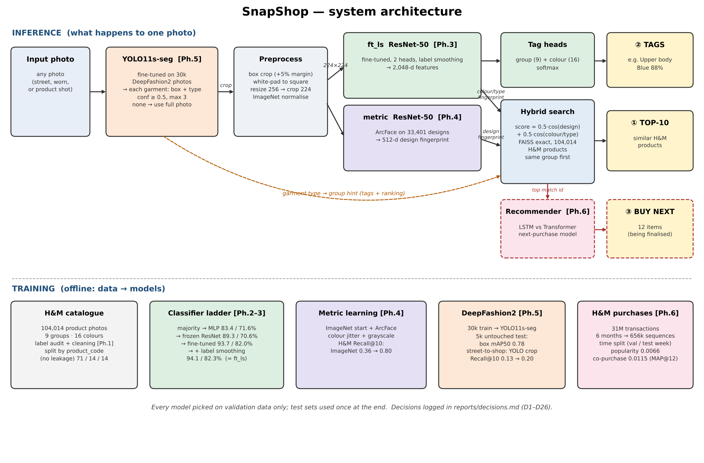

# SnapShop: Street-to-Shop Visual Search & Recommendation

**Any clothing photo in → every garment found → its tags, the 10 most similar products from a 104K-item H&M catalogue, and what to buy next.**

<!-- DEMO GIF (step 2):  -->

| Output | How |
|---|---|
| **Garments found** | YOLO11s-seg trained on 30K DeepFashion2 street photos |
| **Tags** (9 product groups, 16 colours) | Multi-task ResNet-50, fine-tuned with label smoothing |
| **Top-10 similar products** | ArcFace design embeddings + classifier colour/type embeddings, hybrid cosine search with FAISS over 104,014 products |
| **Buy next** (12 items) | LSTM next-item model trained on 31M purchases; the photo's top match is the input |

Built as an individual Deep Learning project (CSAI3027P, UPES), on a laptop with an RTX 3050 (6 GB).



## Results (held-out test data, evaluated once)

| Component | Test set | Result | Baseline |
|---|---|---|---|
| Tags: product group | 14,860 unseen products | **93.9%** accuracy, macro-F1 **0.905** | majority class 40.7% |
| Tags: colour | 14,860 unseen products | **82.8%** accuracy, macro-F1 **0.756** | majority class 21.2% |
| Design search (ArcFace) | 11,441 queries vs 104,014 products | Recall@10 **0.801**, Recall@1 0.493 | ImageNet ResNet-50: 0.352 |
| Hybrid search (final, α = 0.5) | same queries | Recall@10 0.485 · same type in top 10: **93%** · same colour: **71%** | ImageNet: 88% / 47% |
| Garment detector | 5,000 unseen DeepFashion2 photos | box mAP50 **0.779**, mask mAP50 0.600 | |
| Street → shop search | 3,000 street photos vs shop gallery | Recall@10 **0.204** with YOLO crops vs 0.125 full photo (**+63%**) | |
| Buy next (LSTM) | 68,984 customers, week 16–22 Sep 2020 | MAP@12 **0.0200** | co-purchase 0.0106 · popularity 0.0087 |

Every model and setting was chosen on the validation set; the test set was touched once, at the end (`src/evaluate_test.py` → `runs/test_results.json`).

### How the classifier got there (validation)

| Model | Group acc | Colour acc |
|---|---|---|
| Majority class | 40.7% | 21.2% |
| MLP on 32×32 pixels | 83.4% | 71.6% |
| ResNet-50 frozen + linear heads | 89.3% | 70.6% |
| ResNet-50 fine-tuned (2 heads) | 93.7% | 82.0% |
| **+ label smoothing 0.1 (final)** | **94.1%** | **82.3%** |

## What makes it more than a tutorial

- **Leakage-free splits.** Colour variants of one design are near-identical, so the catalogue is split by `product_code` (StratifiedGroupKFold, 0 designs shared across splits). The recommender uses a **time split** (train → 8 Sep, val 9–15 Sep, test 16–22 Sep 2020).
- **A baseline for everything.** Majority class and MLP for tags, ImageNet features for search, full photo vs crops for street photos, popularity and co-purchase counts for recommendations.
- **Metric learning when fine-tuning failed.** Fine-tuning for tags made embeddings cluster by colour and *hurt* design search (Recall@10 0.36 → 0.18). ArcFace (s = 30, m = 0.3) raised it to 0.80.
- **Ablations on real street photos.** Full photo vs YOLO box vs perfect box vs perfect mask, across 5 hybrid weights. Box crops matched mask crops, so the pipeline uses boxes.
- **Error analysis.** Confusion matrices, most-confident-mistake galleries, a label audit that predicted the "Metal" jewellery shortcut before training (confirmed: 51% of non-metal jewellery predicted Metal).
- **Every decision logged** with options, evidence and reason: [`reports/decisions.md`](reports/decisions.md) (28 decisions).

## Run it

```bash
conda create -n snapshop python=3.11 -y && conda activate snapshop
pip install torch torchvision --index-url https://download.pytorch.org/whl/cu132
pip install -r requirements.txt

python src/app.py                                   # dashboard at http://127.0.0.1:7860
python src/predict.py photo.jpg --match balanced    # command line: tags + top-10 + buy next
```

Weights (`runs/*.pt`) and data are not in the repo (size + licences); the pipeline below rebuilds them.

## Pipeline

| Phase | Script | Output |
|---|---|---|
| 1 Data | `src/data/prepare_labels.py`, `prepare_transactions.py`, `make_images.py`, `make_splits.py` | clean labels, 104,014 cached 256 px images, leakage-free split |
| 2 MLP baseline | `src/data/make_mlp_dataset.py`, `notebooks/04_mlp.ipynb` | 32×32 pixel MLP |
| 3 Tags | `src/data/extract_features.py`, `notebooks/05_cnn.ipynb`, `src/train_finetune.py`, `notebooks/06_finetune_eval.ipynb` | frozen vs fine-tuned ResNet-50, error analysis |
| 4 Search | `src/extract_embeddings.py --model {imagenet,ft_ls,metric}`, `src/train_metric.py`, `notebooks/07_search.ipynb` | ArcFace embeddings, FAISS hybrid search, Recall@K |
| 5 Street photos | `src/data/make_yolo_df2.py`, `make_yolo_df2_test.py`, YOLO training (below), `src/eval_street2shop.py` | detector + street-to-shop ablation |
| 6 Buy next | `src/data/make_sequences.py`, `notebooks/08_recommender.ipynb`, `src/train_recommender.py --model {lstm,transformer}` | baselines + LSTM / transformer |
| 7 Integration | `src/predict.py`, `src/app.py`, `src/evaluate_test.py` | CLI, dashboard, final test numbers |

```bash
yolo segment train model=yolo11s-seg.pt data=data/processed/df2_yolo/df2.yaml epochs=25 patience=6 batch=8 imgsz=640 project=runs/yolo name=df2_y11s
```

## Data & licences

- [H&M Personalized Fashion Recommendations](https://www.kaggle.com/competitions/h-and-m-personalized-fashion-recommendations) (Kaggle): 105K products with photos, 31M transactions. Competition data, non-commercial use.
- [DeepFashion2](https://github.com/switchablenorms/DeepFashion2): street and shop clothing photos with boxes and masks. Research licence; images are not redistributed here.
- [Ultralytics YOLO](https://github.com/ultralytics/ultralytics) is AGPL-3.0.

Details, known issues and biases: [`reports/dataset_card.md`](reports/dataset_card.md).

## Limitations

- Clothes photographed sideways search poorly (CNN features are not rotation-invariant).
- Tags on worn garments are weaker than on product shots; YOLO's garment type is used as a hint to correct them.
- YOLO's trousers/shorts masks come out empty, so crops use boxes.
- MAP@12 is small in absolute terms (people buy ~2 of ~30K items a week); the LSTM roughly doubles counting-based recommendations.

## AI assistance disclosure

Claude (Anthropic) was used as a tutor and coding assistant: explaining concepts, suggesting approaches and drafting parts of the code. All runs, results and decisions were executed, checked and logged by the author.
