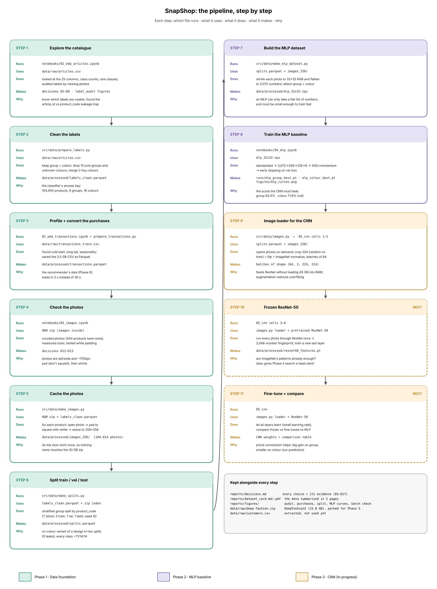

# SnapShop: Street-to-Shop Visual Product Search & Recommendation

Upload **any clothing photo** → get:
1. **Top-10 visually similar H&M products** (visual search)
2. **Attribute tags**: product group + colour (CNN classifier)
3. **"Buy next" recommendations** driven by the photo (sequence model on purchase history)

Deep Learning PBL (CSAI3027P), UPES. Individual project.

## Status

| Phase | What | Status |
|---|---|---|
| 1 | Data foundation: label cleaning + audits, image cache, leakage-free split | ✅ |
| 2 | MLP baseline (32×32 RGB pixels) | ✅ |
| 3 | CNN classifier: ResNet-50 frozen vs fine-tuned (multi-task) | 🔄 |
| 4 | Visual search: embeddings + FAISS, Recall@K | ⏳ |
| 5 | Street photos: garment detection/segmentation (DeepFashion2) | ⏳ |
| 6 | Recommender: popularity vs co-purchase vs LSTM vs transformer | ⏳ |
| 7 | Integration, demo, report | ⏳ |

## Results so far (validation set)

| Model | Group acc | Group macro-F1 | Colour acc | Colour macro-F1 |
|---|---|---|---|---|
| Majority class | 40.7% | – | 21.2% | – |
| MLP (32×32 RGB, standardized) | 83.4% | 0.730 | 71.6% | 0.599 |
| ResNet-50 frozen + linear head | 89.3% | 0.835 | 70.6% | 0.575 |
| **ResNet-50 fine-tuned (2 heads)** | **93.7%** | **0.901** | **82.0%** | **0.741** |

9 product groups, 16 colours. Test set untouched until final evaluation.

## Data
- **H&M Personalized Fashion Recommendations** (Kaggle): 105k products, 31M purchases, product photos
- **DeepFashion2**: street-vs-shop clothing photos (detector training/evaluation)

Data is **not** included in this repo (size + licences). Download it from Kaggle into `data/raw/`.

## Pipeline

```
src/data/prepare_labels.py        articles.csv          → labels_clean.parquet   (clean group/colour labels)
src/data/prepare_transactions.py  transactions_train.csv → transactions.parquet
src/data/make_images.py           images (zip)          → images_256/            (pad to square, 256×256)
src/data/make_splits.py           labels                → splits.parquet         (stratified group split by product_code)
src/data/make_mlp_dataset.py      images_256            → mlp_32x32.npz          (MLP baseline input)
src/data/extract_features.py      images_256            → resnet50_features.pt   (frozen ResNet-50 fingerprints)
src/train_finetune.py             images_256            → finetuned_resnet50.pt  (multi-task fine-tune)
```



## Repo layout
```
src/          pipeline scripts and training
notebooks/    EDA, MLP baseline, CNN experiments
reports/      decisions.md (every design choice + evidence), dataset card, figures
```

Every design decision, its alternatives and the evidence behind it: [`reports/decisions.md`](reports/decisions.md)

## Setup
```
conda create -n snapshop python=3.11 -y
conda activate snapshop
pip install -r requirements.txt
```

## AI assistance disclosure
Claude (Anthropic) was used as a tutor and coding assistant: explaining concepts, suggesting approaches and drafting parts of the code. All runs, results and decisions were executed, checked and logged by the author.
